  

# 🚀 Awesome Cloud Integrated Development Environment (Cloud IDE) 🌟

  
  
  
  
  
  

> 💡 A curated list of top **Cloud Integrated Development Environments (Cloud IDEs)**, hosted developer platforms, browser-based coding tools, remote development environments (CDE), and open-source self-hosted alternatives. 🛠️✨

---

## 📑 Table of Contents

- [📊 Market Overview](#-market-overview)
- [🏢 SaaS & Hosted Cloud IDE Platforms](#-saas--hosted-cloud-ide-platforms)
- [🔓 Open-Source & Self-Hosted Cloud IDEs](#-open-source--self-hosted-cloud-ides)
- [🎯 Key Features to Look For](#-key-features-to-look-for)
- [🤝 Contributing](#-contributing)
- [💖 Support & Sponsorship](#-support--sponsorship)
- [⭐ Star History](#-star-history)
- [📄 License](#-license)

---

## 📊 Market Overview

The global Cloud Development Environment (CDE / Cloud IDE) market size is estimated at **$5.2 billion to $6.8 billion** (projected to reach over **$15 billion by 2030** at a ~16-20% CAGR), and the sector is currently **moderately fragmented** with major hyperscalers and developer-ecosystem giants (Microsoft/GitHub, Amazon, Salesforce) coexisting alongside high-growth specialized developer platforms (Gitpod, CodeSandbox, Replit, StackBlitz). 📈🌐

---

## 🏢 SaaS & Hosted Cloud IDE Platforms

The table below lists leading commercial and hosted Cloud IDE platforms, sorted in descending order by parent company size (Market Capitalization / Company Valuation). 💰💼

| 🏷️ Platform | 📝 Description | 🏢 Parent Company Size (Valuation / Market Cap) | 💵 Starting Tier Pricing | 🎁 Free Tier Limits |
| :--- | :--- | :--- | :--- | :--- |
| **[Microsoft / GitHub Codespaces](https://github.com/features/codespaces)** | ☁️ Cloud-hosted, customizable VS Code developer environments powered by Azure VMs with devcontainer support. | ~$3.1T (Microsoft Market Cap) | $0.18/hour (2-core VM; billed per compute core-hour + storage) | Free forever: 60 core-hours of compute and 15 GB of Codespaces storage per month for all personal accounts. |
| **[Amazon AWS Cloud9](https://aws.amazon.com/cloud9/)** | 🛠️ Cloud-based IDE for writing, running, and debugging code with a browser-based code editor, terminal, and AWS integration. | ~$1.9T (Amazon Market Cap) | ~$0.0104/hour (underlying EC2 instance cost, e.g., t3.micro starting rate; no separate IDE fee) | 750 hours/month of EC2 t2.micro / t3.micro execution under AWS Free Tier for 12 months (or within free monthly limits). |
| **[Google Cloud Workstations](https://cloud.google.com/workstations)** | 🔒 Fully managed developer environments on Google Cloud with enterprise security, customizable container images, and VPC support. | ~$1.9T (Alphabet Market Cap) | ~$0.05/hour + workstation cluster management fee ($0.20/cluster/hr + VM usage) | $300 free credits for 90 days on Google Cloud Free Trial (no permanent free cluster compute). |
| **[Salesforce Code Builder](https://developer.salesforce.com/tools/code-builder)** | ⚡ Web-based development environment built on Microsoft Monaco and VS Code optimized specifically for Salesforce developers. | ~$280B (Salesforce Market Cap) | Included in Salesforce CRM subscriptions / Starter Suite ($25/user/month) | 30-day free trial with 20 hours of usage limit for Salesforce Developer Edition orgs. |
| **[Gitpod](https://www.gitpod.io/)** | 🚀 Automated, ephemeral cloud development environments that build directly from Git repositories and Docker configurations. | ~$300M (Venture Valuation) | $9/user/month (Team / Pay-as-you-go starting tier) | Free forever: 50 hours of standard workspace usage per month for individuals. |
| **[Replit](https://replit.com/)** | 🤖 Collaborative in-browser IDE with instant cloud hosting, AI code completion (Ghostwriter), and package management. | ~$3.0B (Venture Valuation) | $20/month ($15/month billed annually for Replit Core) | Free forever: 3 public Repls, basic compute (0.5 vCPU, 512 MB RAM), and 100 MB storage. |
| **[StackBlitz](https://stackblitz.com/)** | ⚡ Instant fullstack web IDE running entirely in-browser on Node.js using WebContainers technology. | ~$150M (Venture Valuation) | $15/user/month ($10/user/month billed annually) | Free forever: Unlimited public projects, in-browser instant compute, community support. |
| **[CodeSandbox](https://codesandbox.io/)** | 📦 Instant cloud development platform for rapid web prototyping and microVM-powered fullstack repositories. | ~$120M (Venture Valuation) | $18/user/month ($15/user/month billed annually for Pro) | Free forever: Unlimited public sandboxes, up to 3 shared workspaces, 2 vCPUs and 2 GB RAM VM specs. |
| **[Codeanywhere](https://codeanywhere.com/)** | 💻 Web-based IDE offering containerized development workspaces, remote SSH/SFTP access, and multi-cloud deployment. | ~$15M (Venture Valuation) | $6/month (billed annually for Basic) | 7-day full feature free trial (no permanent free compute tier). |

---

## 🔓 Open-Source & Self-Hosted Cloud IDEs

Open-source and self-hosted development environments allow you to deploy private, fully customizable remote IDE infrastructure on your own servers, Kubernetes, or cloud VMs. 🖥️🐧

Sorted in descending order by GitHub Stars: ⭐

| 📦 Project | ⭐ GitHub Stars | 📝 Description | 🖥️ Supported Interfaces | 🚀 Deployment Options |
| :--- | :--- | :--- | :--- | :--- |
| **[code-server](https://github.com/coder/code-server)** |  | Run VS Code on any remote machine in the browser with full extension marketplace compatibility. | VS Code Web | Docker, Linux binary, Helm / Kubernetes, npm |
| **[Daytona](https://github.com/daytonaio/daytona)** |  | Open-source Development Environment Manager (IDES / CDE) that automates local and remote workspace provisioning. | VS Code, JetBrains, Terminal, Browser | Docker, Kubernetes, Linux, macOS, Windows |
| **[VSCodium](https://github.com/VSCodium/vscodium)** |  | Community-driven, telemetry-free, and binary-clean open-source build of Microsoft VS Code. | Desktop / Web client | Desktop package, Docker, Flatpak, Snap |
| **[Eclipse Theia](https://github.com/eclipse-theia/theia)** |  | Extensible framework and multi-language platform for building cloud & desktop IDEs and IDE extensions. | Theia IDE, VS Code Extension compatible | Docker, Kubernetes, Desktop (Electron) |
| **[Coder](https://github.com/coder/coder)** |  | Open-source enterprise developer workspace platform on your infrastructure configured via Terraform templates. | Web IDEs, SSH, VS Code, JetBrains | Kubernetes, Docker, Helm, Bare metal |
| **[JupyterLab](https://github.com/jupyterlab/jupyterlab)** |  | Next-generation web-based user interface for Project Jupyter supporting notebooks, code, and data science workflows. | Jupyter Web UI | Docker, Conda, Pip, Kubernetes (JupyterHub) |
| **[DevPod](https://github.com/loft-sh/devpod)** |  | Client-only developer environment tool using `devcontainer.json` on any cloud, Kubernetes, or local machine. | VS Code, Desktop, Browser, SSH | Local CLI, Desktop app, Docker, AWS/GCP/K8s |
| **[noVNC](https://github.com/novnc/noVNC)** |  | HTML5 VNC client enabling full graphical desktop IDEs (IntelliJ, Eclipse, VS Code) in any modern browser. | Any Desktop GUI / Web Browser | Docker, Linux package, WebSockets |
| **[Gitpod (Self-Hosted)](https://github.com/gitpod-io/gitpod)** |  | Automated development environments orchestrator for Kubernetes clusters with prebuild support. | VS Code Web, JetBrains, Desktop SSH | Kubernetes (k3s, EKS, GKE, AKS) |
| **[Jupyter Notebook](https://github.com/jupyter/notebook)** |  | Classic web-based notebook environment for interactive computing, Python, Julia, and R. | Notebook Web UI | Pip, Conda, Docker |
| **[Eclipse Che](https://github.com/eclipse-che/che)** |  | Kubernetes-native cloud IDE and developer workspace orchestrator based on Eclipse Theia and devfile standard. | VS Code Web, Theia | Red Hat OpenShift, Kubernetes |
| **[OpenVSCode Server](https://github.com/gitpod-io/openvscode-server)** |  | Upstream-aligned server running pristine upstream VS Code directly in web browsers. | Upstream VS Code Web | Docker, Linux tarball, Kubernetes |
| **[RStudio Server](https://github.com/rstudio/rstudio)** |  | Browser-based interface to compute engines running R and Python with statistical visualization tools. | RStudio Web Interface | Linux package, Docker |
| **[OpenSumi](https://github.com/opensumi/core)** |  | Framework for building cloud and desktop IDE products with deep VS Code extension compatibility. | Sumi Web & Desktop IDE | Docker, Node.js |
| **[Cloud9 Core](https://github.com/c9/core)** |  | Original open-source core SDK for the Cloud9 IDE, featuring syntax highlighting, key bindings, and collaboration. | Web Browser | Node.js, Linux |

---

## 🎯 Key Features to Look For

When evaluating a Cloud IDE or Remote Development Environment for personal or enterprise use, consider: 🔍✨

1. 📦 **Dev Environment Specification**: Support for standardized container formats like `devcontainer.json` or `devfile.yaml`.
2. ⚡ **Compute Flexibility**: Granular control over vCPU, RAM, GPU acceleration, and automated idle sleep to minimize costs.
3. 👥 **Collaboration & Sharing**: Real-time multiplayer pair programming, shareable preview links, and port forwarding.
4. 🛡️ **Security & Isolation**: Sandboxed microVMs / containers, zero-trust network access, SSO integration, and private VPC peering.
5. 🧩 **Ecosystem Compatibility**: Rich support for VS Code extensions, JetBrains Gateways, and terminal/SSH access.

---

## 🤝 Contributing

Contributions are always welcome! 💖 Please read the contribution guidelines before submitting:
- 🔍 Check existing entries to prevent duplicates.
- 🌟 Ensure open-source repositories are active, maintained, and reputable.
- 🏷️ Provide accurate and transparent pricing for commercial entries.

---

## 💖 Support & Sponsorship

Thank you so much for using and exploring this curated list! 🙏 If you find this repository helpful, please consider:
- ⭐ **Starring** the repository on GitHub
- 🍴 **Forking** and contributing new tools or corrections
- 📢 **Sharing** with fellow developers, teams, and communities
- ☕ **Buying a coffee / sponsoring** via the GitHub Sponsor Dashboard: [https://github.com/sponsors/ishandutta2007](https://github.com/sponsors/ishandutta2007)

Your support keeps this project active, comprehensive, and up-to-date! ✨🙌

---

## 📈 Star History

---

## 📄 License

To the extent possible under law, this work is dedicated to the public domain under [CC0 1.0 Universal](LICENSE). ⚖️
